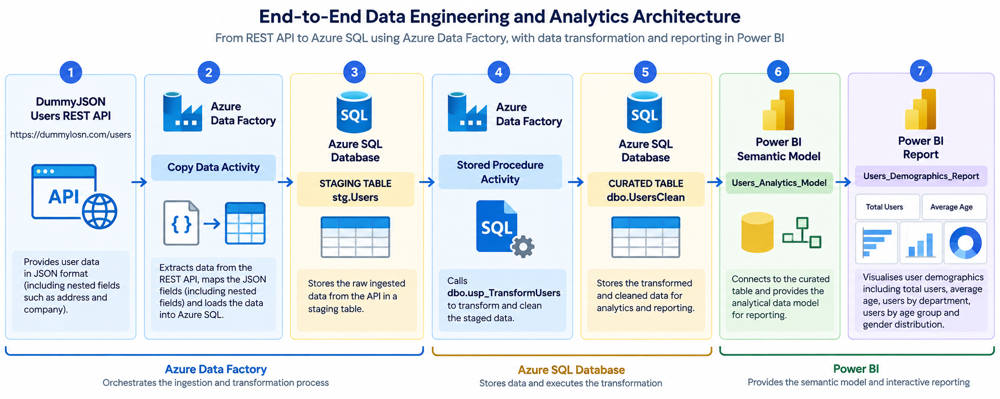
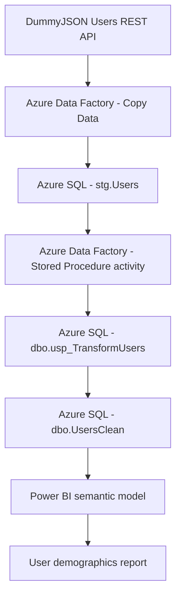
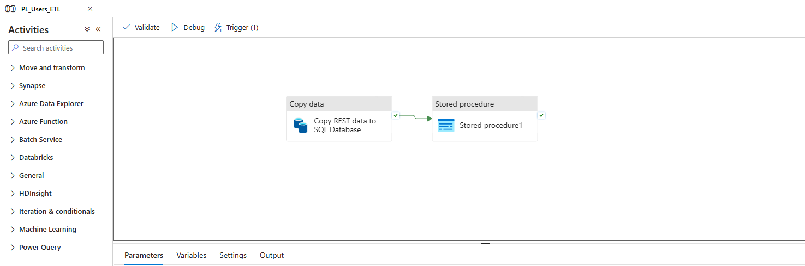
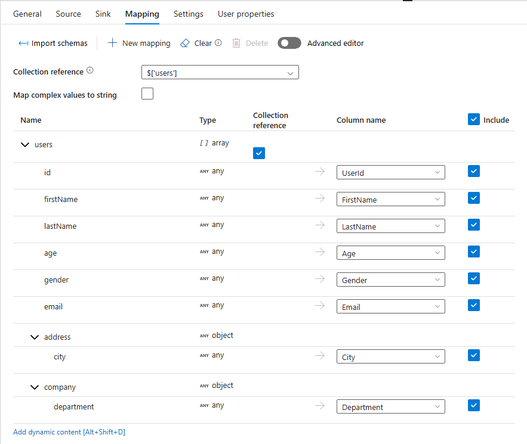
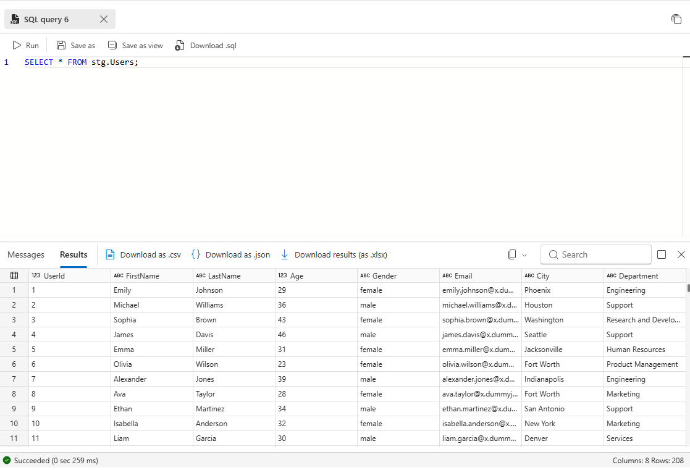
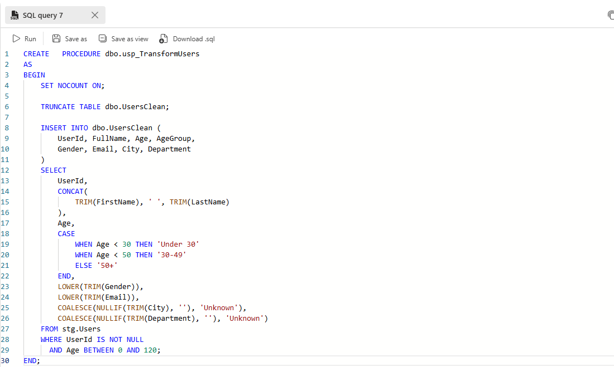
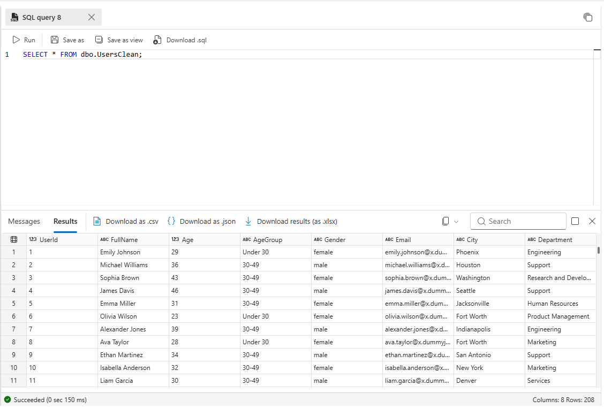
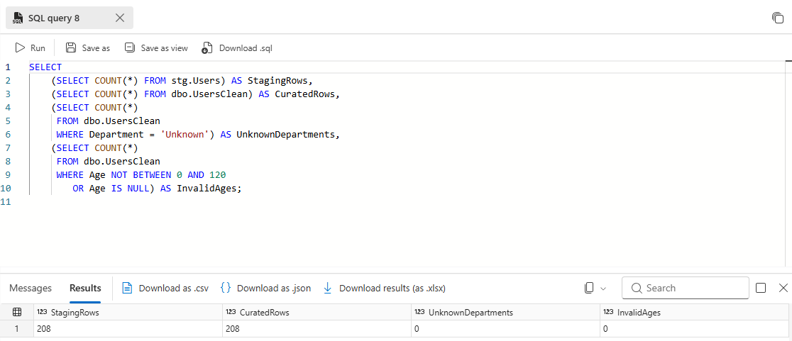
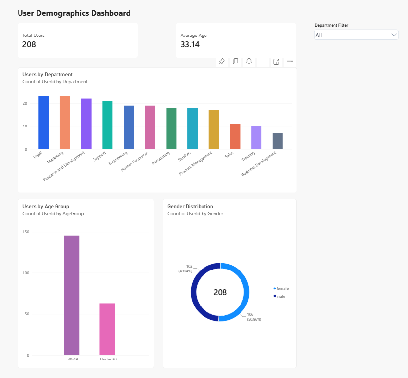

# Azure Data Factory — User Analytics ELT Pipeline

**End-to-end REST API ingestion, SQL-based transformation and Power BI demographics reporting**

An independent data engineering and business intelligence portfolio project that uses **Azure Data Factory** to ingest nested JSON from the [DummyJSON Users API](https://dummyjson.com/users), loads it into a staging table in **Azure SQL Database**, transforms it using a **T-SQL stored procedure**, and serves a cleaned dataset to an interactive **Power BI** report.

> **Data disclaimer:** DummyJSON provides demonstration user records. The charts illustrate the analytics workflow, **not real workforce or customer demographics**.

## Project at a glance

| Layer | Implementation |
|---|---|
| Source | DummyJSON REST API: `/users` |
| Orchestration | Azure Data Factory (Copy Data → Stored Procedure success dependency) |
| Staging | Azure SQL Database: `stg.Users` |
| Transformation | `dbo.usp_TransformUsers` in T-SQL |
| Curated reporting table | `dbo.UsersClean` |
| Reporting | Power BI semantic model `Users_Analytics_Model` and `Users_Demographics_Report` |
| Loading strategy | Full refresh of staging and curated tables |
| Main skills | Nested JSON mapping, SQL data cleansing, ELT, validation, troubleshooting, BI |

## Architecture





The core pattern is **ELT**: data is extracted from the source, loaded to SQL staging, and then transformed **inside Azure SQL Database**. ADF manages the activity sequence; SQL runs the transformation logic.

## 1. REST API ingestion and mapping

The [DummyJSON Users API](https://dummyjson.com/users) returns a `users` array containing both flat and nested user attributes. In ADF, a REST linked service and source dataset are used by a **Copy Data** activity. The mapping uses the collection reference `$['users']` so each item becomes one staging row.

| JSON source attribute | SQL staging column |
|---|---|
| `id` | `UserId` |
| `firstName` | `FirstName` |
| `lastName` | `LastName` |
| `age` | `Age` |
| `gender` | `Gender` |
| `email` | `Email` |
| `address.city` | `City` |
| `company.department` | `Department` |

The nested-field mapping matters: an incorrect `company.department` mapping initially caused the downstream report to show `Unknown` departments. The mapping was corrected at the ingestion stage and the reporting data refreshed.





## 2. Azure SQL staging

ADF loads the extracted attributes into `stg.Users`, preserving the individual source fields in a relational table. The staging table allows validation of the imported data before applying business transformations.

This portfolio lab uses a **full-refresh strategy**, clearing previous staging records before the next load. For an example of the documented schema, see [`sql/schema_reference.sql`](sql/schema_reference.sql). Replace the reference with a script exported from your actual database if the deployed definition differs.



## 3. SQL transformation with a stored procedure

After ingestion succeeds, an ADF **Stored Procedure** activity executes `dbo.usp_TransformUsers` in Azure SQL Database.

Key transformations documented in the project:

- Combine trimmed first and last names into `FullName`.
- Derive `AgeGroup`: **Under 30**, **30–49**, or **50+**.
- Standardise text with `TRIM()` and `LOWER()`, including gender and email.
- Replace missing or blank `Department` and `City` with `Unknown`.
- Exclude records whose ages are outside **0–120** or whose user identifier is missing.
- Rebuild the curated `dbo.UsersClean` table for reporting.

**Actual implementation code:** add a script exported from your deployed stored procedure as `sql/usp_TransformUsers.sql`. The starter repository deliberately does **not** invent the full stored procedure source.





## 4. Validation and troubleshooting

I validated the staging and curated record counts, reviewed the cleaned output, and checked the department distributions. Example queries are available in [`sql/validation_queries.sql`](sql/validation_queries.sql). Run these against your own database and verify the results.

Technical challenges included:

1. **Azure SQL firewall connectivity:** the ADF integration runtime was initially blocked by Azure SQL firewall rules; reviewing and updating permitted connectivity resolved the issue.
2. **Source-to-sink mapping:** ADF initially lacked valid destination field mappings; the staging schema and column mappings were corrected.
3. **Missing department information:** an incorrect nested JSON mapping produced `Unknown` values; tracing the issue from Power BI back to ADF fixed the source field mapping.
4. **Stale report data:** after SQL was corrected, the imported Power BI data had to be refreshed to show the latest results.




## 5. Power BI user demographics report

The curated `dbo.UsersClean` table feeds the `Users_Analytics_Model` semantic model and `Users_Demographics_Report`.

The report includes:

| Visual | Purpose |
|---|---|
| **Total Users** | Number of curated user records |
| **Average Age** | Average age in the selected report context |
| **Users by Department** | Compare department populations |
| **Users by Age Group** | Explore SQL-derived age bands |
| **Gender Distribution** | Proportional demographic breakdown |

The dashboard demonstrates how a cleaned SQL dataset can support accessible, self-service reporting. These are **synthetic data visualisations**, not conclusions about an actual organisation.



## Repository contents

```text
.
├── README.md
├── .gitignore
├── docs/
│   ├── SCREENSHOT_CHECKLIST.md
│   └── images/
│       ├── architecture.png
│       ├── adf-pipeline.png
│       ├── adf-json-mapping.png
│       ├── adf-successful-run.png
│       ├── sql-staging.png
│       ├── sql-stored-procedure.png
│       ├── sql-curated.png
│       ├── sql-validation.png
│       └── powerbi-dashboard.png
├── sql/
│   ├── schema_reference.sql
│   ├── validation_queries.sql
└── sample-data/
    └── users_sample.json       
```

**No ARM templates / ADF JSON exports and no Power BI `.pbix` are published.** Instead, pipeline and dashboard screenshots document these components. The stored-procedure source and SQL validations provide inspectable engineering evidence.

## Running or reproducing the project

This repository documents a cloud-hosted demonstration and is **not a one-click deployment**. Reproducing it requires access to Azure Data Factory, Azure SQL Database, the DummyJSON API, and Power BI. Create equivalent staging/curated tables, configure an ADF REST-to-SQL Copy activity with the nested-field mappings above, deploy the actual SQL transformation procedure, and run the ADF pipeline so that transformation follows ingestion. Connect Power BI to the resulting curated table and refresh the report after each data update.

## Limitations and potential improvements

- **Synthetic user data**: results demonstrate reporting rather than real demographics.
- **Full refresh**: an incremental or change-tracking approach would be preferable for larger datasets.
- **Validation**: additional automated null, duplicate and business-rule checks could be introduced.
- **Security**: managed identities, more restrictive networking and secret-management controls would be appropriate for production.
- **Monitoring**: add retries, logging and failure notifications.
- **Refresh coordination**: automatically refresh Power BI after successful database updates.
- **Scheduling**: a monthly ADF trigger can be documented here *if it has actually been configured and verified*; the available project notes do not conclusively establish the schedule as deployed.

## Security and sharing

Before publishing, remove passwords, tokens, connection strings and any sensitive subscription/account details from SQL files, screenshots and notes. Although DummyJSON contains demonstration records, avoid posting a large dataset with unnecessary names, emails or addresses. Keep only a small representative sample.

---

*Independent Azure data engineering portfolio project. The repository showcases a proof-of-concept ELT workflow and Power BI reporting, not a production deployment.*
